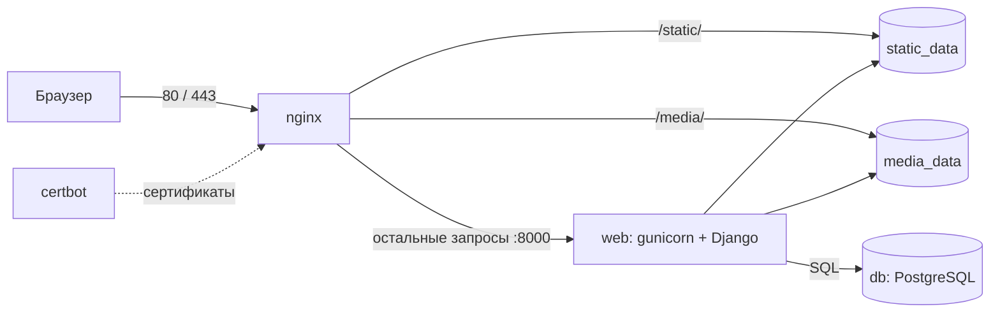
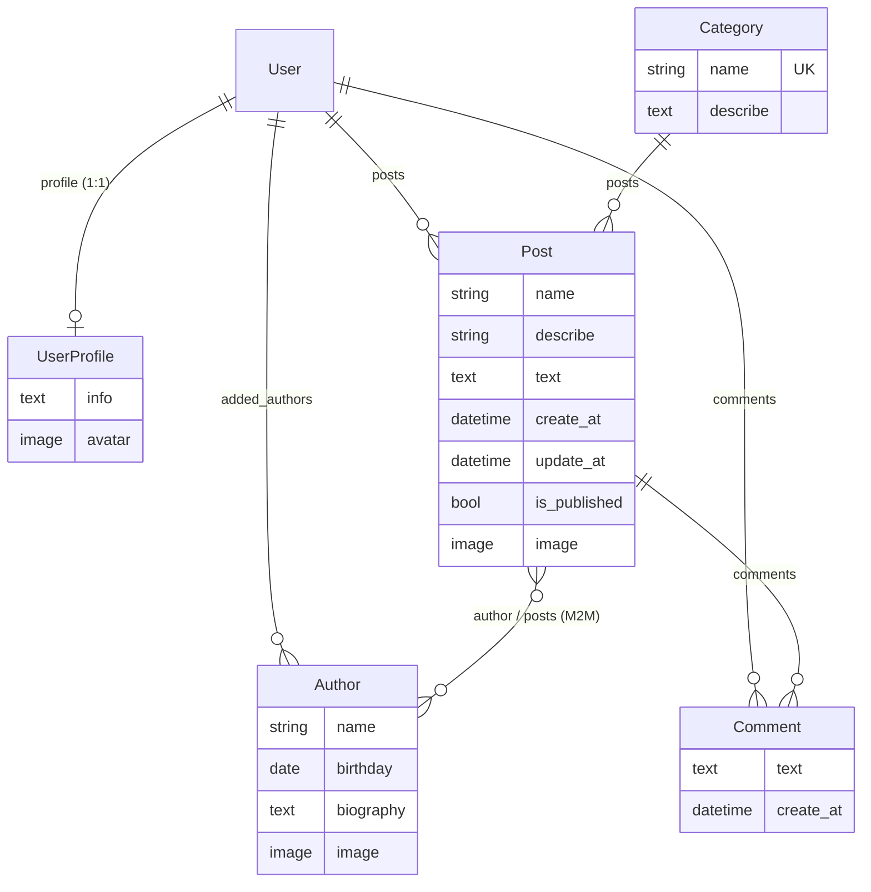

# BookSpace

BookSpace — веб-приложение на Django для публикации материалов о литературных произведениях. Пользователи регистрируются, создают публикации, привязывают к ним категории и авторов произведений, комментируют записи друг друга и ведут личный профиль.

Сайт: <https://bookspace.fun>

## Возможности

- Регистрация, вход, выход и восстановление пароля (встроенная аутентификация Django).
- Личный профиль (аватар, «о себе») и публичные профили пользователей.
- Публикации: создание, просмотр, редактирование, удаление. Каждая привязана к одной категории и к одному или нескольким авторам произведения.
- Авторы произведений: список, страница автора с его публикациями, создание, редактирование, удаление.
- Категории: список и страница категории с публикациями.
- Комментарии к публикациям (только для авторизованных).
- Поиск публикаций по названию (без учёта регистра).
- Пагинация списков (по 4 записи на странице).
- Защита от подбора пароля: 5 неудачных попыток блокируют вход на 30 минут (django-axes).
- Собственные страницы ошибок 404 и 500.

## Технологии

| Слой | Что используется |
| --- | --- |
| Язык и фреймворк | Python 3.13, Django 6.1.2 (Class-Based Views, ModelForm, Django ORM) |
| База данных | PostgreSQL 17 в Docker; SQLite для локальной разработки |
| WSGI-сервер | gunicorn (1 worker, 2 потока, timeout 60 с) |
| Веб-сервер | nginx: раздаёт статику и медиа, проксирует остальное в gunicorn |
| Контейнеры | Docker, Docker Compose |
| TLS-сертификаты | Let's Encrypt через certbot (отдельный сервис в профиле `tools`) |
| Безопасность | django-axes, HTTPS-настройки Django, скрытый адрес админки |
| Фронтенд | Django-шаблоны, SCSS (Sass) → CSS, шрифты Google Fonts |
| Прочее | Pillow (изображения), python-dotenv (переменные окружения), psycopg 3 |

## Архитектура



Три постоянных сервиса: `db`, `web`, `nginx`. Четвёртый, `certbot`, запускается вручную (профиль `tools`).

Тома Docker:

| Том | Назначение | Кто пишет | Кто читает |
| --- | --- | --- | --- |
| `postgres_data` | файлы базы данных | db | db |
| `media_data` | загруженные пользователями изображения | web | web, nginx (ro) |
| `static_data` | результат `collectstatic` | web | nginx (ro) |
| `certbot_www` | файлы для проверки домена (ACME challenge) | certbot | nginx (ro) |
| `certbot_conf` | выпущенные сертификаты | certbot | nginx (ro) |

## Структура проекта

```text
.
├── account/              # регистрация, профили (модель UserProfile)
├── blog/                 # публикации, авторы, категории, комментарии
├── config/               # настройки проекта (settings.py), корневые маршруты, wsgi/asgi
├── nginx/default.conf    # конфигурация nginx
├── static/
│   ├── scss/             # исходные стили (главный файл main.scss)
│   └── css/              # скомпилированный CSS (коммитится в репозиторий)
├── templates/
│   ├── base.html         # общий каркас: шапка, меню, подвал
│   ├── blog/             # шаблоны публикаций, авторов, категорий
│   ├── account/          # профили и регистрация
│   ├── registration/     # вход и восстановление пароля
│   ├── includes/         # пагинация
│   └── 404.html, 500.html
├── Dockerfile            # образ приложения
├── compose.yml           # сервисы и тома
├── requirements.txt      # зависимости Python (версии зафиксированы)
├── package.json          # скрипты компиляции SCSS
└── manage.py
```

Папки `media/` и `staticfiles/` создаются во время работы и в репозиторий не попадают.

## Переменные окружения

Все параметры читаются из файла `.env` в корне проекта (`python-dotenv` локально, `env_file` в Docker). Файл `.env` не коммитится и не попадает в образ.

| Переменная | Обязательна | Значение по умолчанию | Описание |
| --- | --- | --- | --- |
| `SECRET_KEY` | в production — да | в режиме `DEBUG` подставляется небезопасный ключ | секретный ключ Django |
| `ADMIN_URL` | да | — | адрес админки, например `my-secret-panel/` (без ведущего `/`, с `/` на конце) |
| `DEBUG` | нет | `True` | в Docker принудительно `False` (задано в `compose.yml`) |
| `ALLOWED_HOSTS` | в production — да | `localhost,127.0.0.1` | список хостов через запятую |
| `CSRF_TRUSTED_ORIGINS` | в production — да | пусто | например `https://bookspace.fun,https://www.bookspace.fun` |
| `DB_ENGINE` | нет | `sqlite` | `postgresql` включает PostgreSQL (в Docker задано в `compose.yml`) |
| `DB_NAME`, `DB_USER`, `DB_PASSWORD` | для PostgreSQL — да | — | параметры БД; те же значения использует контейнер `db` |
| `DB_HOST` | нет | `db` | в Docker задано в `compose.yml` |
| `DB_PORT` | нет | `5432` | порт PostgreSQL |

Пример `.env` для сервера:

```dotenv
SECRET_KEY=длинная-случайная-строка
ADMIN_URL=my-secret-panel/
ALLOWED_HOSTS=bookspace.fun,www.bookspace.fun
CSRF_TRUSTED_ORIGINS=https://bookspace.fun,https://www.bookspace.fun
DB_NAME=bookspace
DB_USER=bookspace
DB_PASSWORD=надёжный-пароль
```

Сгенерировать `SECRET_KEY`:

```bash
python -c "from django.core.management.utils import get_random_secret_key; print(get_random_secret_key())"
```

## Локальный запуск (без Docker)

Нужны Python 3.13+ и (по желанию) Node.js для компиляции SCSS. Используется SQLite.

```bash
git clone https://github.com/dmitryi-88/blog-deploy.git
cd blog-deploy

python -m venv .venv
source .venv/bin/activate        # Windows PowerShell: .\.venv\Scripts\Activate.ps1
pip install -r requirements.txt
```

Создайте `.env`:

```dotenv
DEBUG=True
ADMIN_URL=admin/
```

Дальше:

```bash
python manage.py migrate
python manage.py createsuperuser
python manage.py runserver
```

Сайт: <http://127.0.0.1:8000/> (корень перенаправляет на `/blog/`). В режиме `DEBUG` Django сам отдаёт медиа-файлы.

## Деплой на сервер (Docker Compose)

Требуется сервер с Docker и Docker Compose, домен, направленный на IP сервера, открытые порты 80 и 443.

### 1. Первый запуск

```bash
git clone https://github.com/dmitryi-88/blog-deploy.git
cd blog-deploy
nano .env                         # заполнить по таблице выше

docker compose up -d --build
docker compose exec web python manage.py migrate
docker compose exec web python manage.py createsuperuser
```

Миграции **не выполняются автоматически**: контейнер `web` при старте делает только `collectstatic` и запускает gunicorn. После первого запуска и после каждого обновления с новыми миграциями их нужно применять вручную командой `migrate`.

Порядок запуска обеспечивает `compose.yml`: `web` стартует только после того, как healthcheck базы (`pg_isready`) стал успешным, а `nginx` — после `web`.

### 2. HTTPS

В `nginx/default.conf` из репозитория описан HTTP-сервер на порту 80: он отдаёт `/.well-known/acme-challenge/` для certbot, `/static/`, `/media/` и проксирует остальное в `web:8000`. В `compose.yml` опубликован только порт 80.

В production-режиме Django включает `SECURE_SSL_REDIRECT`, поэтому для работы сайта нужен HTTPS. Порядок такой:

1. Выпустить сертификат (домен должен открываться по HTTP):

   ```bash
   docker compose run --rm certbot certonly --webroot -w /var/www/certbot \
     -d bookspace.fun -d www.bookspace.fun
   ```

2. Добавить в `nginx/default.conf` блок `server` на порту 443 с путями к сертификатам (`/etc/letsencrypt/live/bookspace.fun/fullchain.pem` и `privkey.pem`) и теми же `location`-блоками, а в `compose.yml` добавить `"443:443"` в `ports` сервиса `nginx`.
3. Перезапустить nginx: `docker compose up -d --force-recreate nginx`.

Заголовок `X-Forwarded-Proto` передаётся из nginx, а Django доверяет ему через `SECURE_PROXY_SSL_HEADER`, поэтому приложение корректно определяет HTTPS за прокси.

Продление сертификата:

```bash
docker compose run --rm certbot renew
docker compose exec nginx nginx -s reload
```

### 3. Обновление

```bash
git pull
docker compose up -d --build
docker compose exec web python manage.py migrate   # если есть новые миграции
```

При старте контейнер заново выполняет `collectstatic`, поэтому новая статика попадает в том `static_data` автоматически.

### 4. Полезные команды

```bash
docker compose ps                         # состояние сервисов
docker compose logs -f web                # логи приложения
docker compose logs -f nginx              # логи nginx
docker compose exec web python manage.py shell
docker compose exec db psql -U <DB_USER> -d <DB_NAME>
```

Резервная копия базы и её восстановление (подставьте значения `DB_USER` и `DB_NAME` из `.env`):

```bash
docker compose exec -T db pg_dump -U <DB_USER> <DB_NAME> > backup.sql
docker compose exec -T db psql -U <DB_USER> -d <DB_NAME> < backup.sql
```

Медиа-файлы лежат в томе `media_data`; их тоже нужно включать в резервное копирование.

Письма для сброса пароля сейчас выводятся в логи (`EMAIL_BACKEND` — консольный): смотрите их командой `docker compose logs web`.

## Стили (SCSS)

Исходники — `static/scss/`, главный файл `static/scss/main.scss` подключает остальные модули. Скомпилированный `static/css/main.css` лежит в репозитории и подключается в `templates/base.html`. В Docker-образе Node.js нет, поэтому **после правки SCSS CSS нужно собрать локально и закоммитить**.

```bash
npm install
npm run scss          # следить за изменениями
npm run scss:build    # однократная сборка (сжатый вывод)
```

## Маршруты

| URL | Имя | Назначение | Доступ |
| --- | --- | --- | --- |
| `/` | `home` | перенаправление на `/blog/` | все |
| `/blog/` | `blog:post_list` | лента публикаций | все |
| `/blog/<id>/` | `blog:post_detail` | публикация и комментарии | все |
| `/blog/create/` | `blog:post_create` | создание публикации | вход |
| `/blog/<id>/update/` | `blog:post_update` | редактирование | владелец |
| `/blog/<id>/delete/` | `blog:post_delete` | удаление | владелец |
| `/blog/<id>/comment/` | `blog:add_comment` | добавить комментарий | вход |
| `/blog/authors/` | `blog:author_list` | список авторов | все |
| `/blog/authors/create/` | `blog:author_create` | добавить автора | вход |
| `/blog/authors/<id>/` | `blog:author_detail` | страница автора | все |
| `/blog/authors/<id>/update/` | `blog:author_update` | редактирование автора | владелец |
| `/blog/authors/<id>/delete/` | `blog:author_delete` | удаление автора | владелец |
| `/blog/categories/` | `blog:category_list` | список категорий | все |
| `/blog/categories/<id>/` | `blog:category_detail` | страница категории | все |
| `/blog/search/?q=...` | `blog:post_search` | поиск по названию | все |
| `/account/register/` | `register` | регистрация | все |
| `/account/login/`, `/account/logout/` | `login`, `logout` | вход и выход | все |
| `/account/password_reset/` и связанные | `password_reset…` | восстановление пароля | все |
| `/account/profile/` | `profile` | личный профиль | вход |
| `/account/profile/edit/` | `profile_edit` | редактирование профиля | вход |
| `/account/users/<username>/` | `public_profile` | публичный профиль | все |
| `/<ADMIN_URL>` | — | админка Django | суперпользователь |

Выход выполняется POST-запросом (кнопка в шапке).

## Модель данных



| Модель | Приложение | Связи и правила удаления |
| --- | --- | --- |
| `User` | django.contrib.auth | стандартная модель Django |
| `UserProfile` | account | `user` — OneToOne на `User`, `CASCADE`, `related_name="profile"` |
| `Category` | blog | `name` уникально; публикации — `related_name="posts"` |
| `Author` | blog | `writer` — ForeignKey на `User`, `CASCADE`, `related_name="added_authors"` |
| `Post` | blog | `category` — FK, **`PROTECT`**; `author` — ManyToMany на `Author` (`related_name="posts"`); `writer` — FK на `User`, `CASCADE` |
| `Comment` | blog | `post` — FK, `CASCADE`; `writer` — FK на `User`, `CASCADE` |

Что важно помнить:

- `Author` — автор **литературного произведения** (Толстой, Оруэлл), а `Post.writer` и `Author.writer` — **пользователь сайта**, который добавил запись.
- Категорию нельзя удалить, пока в ней есть публикации (`PROTECT`).
- Удаление пользователя удаляет его публикации, добавленных им авторов и комментарии.
- Удаление автора произведения не удаляет публикации — убирается только связь.
- Публикации сортируются по `-create_at` (новые первыми), комментарии — так же.
- Загрузки: `post_images/`, `authors_images/`, `avatars/` внутри `MEDIA_ROOT`.

## Права доступа и безопасность

- Создавать публикации, авторов и комментарии могут только вошедшие пользователи (`LoginRequiredMixin`).
- Редактирование и удаление защищены на уровне запроса: `UpdateView` и `DeleteView` берут записи из `filter(writer=request.user)`, поэтому чужая запись даёт 404, а не просто скрытую кнопку в шаблоне.
- В ленте, поиске и на странице публикации показываются только записи с `is_published=True`.
- **django-axes**: 5 неудачных входов блокируют вход на 30 минут, счётчик сбрасывается после успешного входа. IP определяется по `X-Forwarded-For` (nginx перезаписывает этот заголовок значением `$remote_addr`).
- Админка доступна по адресу из `ADMIN_URL`; на `/admin` и `/admin/` nginx возвращает 404.
- В production (`DEBUG=False`): `SECURE_SSL_REDIRECT`, `SESSION_COOKIE_SECURE`, `CSRF_COOKIE_SECURE`, HSTS.
- nginx ограничивает размер загружаемых файлов до 20 МБ (`client_max_body_size`).
- `.env` исключён из git и из Docker-образа (`.gitignore`, `.dockerignore`).

## Известные ограничения

- Категории создаются только через админку; формы для них на сайте нет.
- Поле `is_published` в форме публикации отсутствует: все публикации публикуются сразу, скрыть можно только в админке.
- Профиль `UserProfile` создаётся при регистрации через сайт. Пользователь, созданный через `createsuperuser` или админку, профиля не имеет, и страница редактирования профиля у него не откроется, пока профиль не создан (например, в админке или через `shell`). Модель `UserProfile` в админке не зарегистрирована — при необходимости добавьте `admin.site.register(UserProfile)`.
- Автоматических тестов нет (`tests.py` пустые).
- Модель `Author.writer` и файл миграции `blog/0001_initial.py` расходятся по `verbose_name` («Добавил пользователь» против «Автор публикации»): `python manage.py makemigrations` создаст небольшую миграцию.
- HSTS в настройках стоит на 3600 секунд — для постоянной работы по HTTPS значение стоит увеличить (например, до 31536000).
- Почта работает через консольный backend, реальные письма не отправляются.
